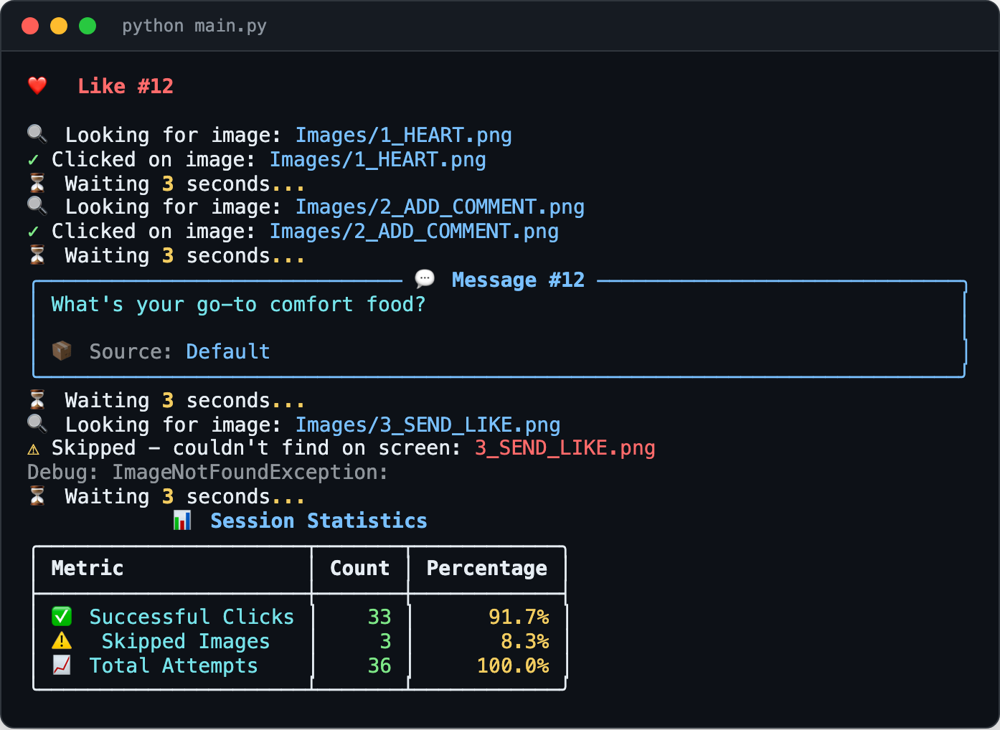
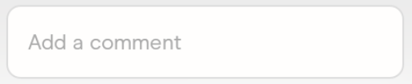

<div align="center">

<h1>Auto-Swiper</h1>

<p><b>Screen-matching auto-liker for Hinge in an emulator.</b></p>

<p><i>A PyAutoGUI script that finds buttons on screen by picture, clicks through a like, and types a short message from a text file.</i></p>

<h6>


</h6>

<a href="#how-it-works"><b>How it works</b></a> ·
<a href="#run-it"><b>Run it</b></a> ·
<a href="#messages"><b>Messages</b></a> ·
<a href="#limits"><b>Limits</b></a>

<br><br>



<sub>Sample terminal output in the script's own format, made without running the automation. No app screen shown.</sub>

</div>

<br>

## Why

A side project from 2022, tidied up in 2025 with a Rich terminal UI and PyInstaller builds. It
drives the Hinge Android app running in BlueStacks (or another emulator) on the desktop. It
doesn't touch the app or its API: it only looks at the screen and moves the mouse, the way a
person would. Automating a third-party app this way may break its terms of service; treat
it as a desktop-automation exercise.

## How it works

<table>
<tr>
<td width="33%" valign="top">

**1 · Find**

`pyautogui.locateCenterOnScreen` looks for a template image (grayscale, OpenCV, confidence
0.5) and returns the centre of the match.

</td>
<td width="33%" valign="top">

**2 · Click and type**

Heart, then "Add a comment", then a random line from the message files is typed, then
"Send Like", with a 3-second wait between steps.

</td>
<td width="33%" valign="top">

**3 · Count**

Missing buttons are skipped, not fatal. Clicks and skips are tallied in a table and
appended to `log.txt`. It stops after 200 likes or Ctrl+C.

</td>
</tr>
</table>

The templates it looks for live in `Images/`, cropped from the app's own buttons:

<div align="center">
&nbsp;&nbsp;&nbsp;&nbsp;&nbsp;&nbsp;
</div>

## Run it

Needs Python 3.8 or newer, a desktop session, and the emulator window open and visible.
On macOS, give the terminal Accessibility and Screen Recording permission.

```bash
git clone https://github.com/parthchandak02/auto-swiper.git
cd auto-swiper
pip install -r requirements.txt   # pillow, opencv-python, pyautogui, rich
python main.py --help             # usage panel
python main.py --demo             # preview the terminal UI, no clicking
python main.py                    # start; move the mouse to a screen corner to abort
```

PyAutoGUI's fail-safe is on: slamming the pointer into a corner stops the script.

## Messages

Each like carries one line picked at random from two sources:

- **`jokes.txt`** in the repo: 14 bundled defaults.
- **`~/Documents/AutoSwiper_CustomJokes.txt`**: your own lines, one per line, `#` for comments.
  Created on first run; `python main.py --jokes` opens its folder.

## Limits

- **Resolution-bound.** Template matching only works when the emulator renders the buttons at
  the same size and look as the crops in `Images/`. A redesign of the app breaks it.
- **No prompt awareness.** It doesn't read the profile; the message is random.
- **Unmaintained.** Last changed in September 2025. `Images/0_CHECK_FOR_ROSE.png`,
  `0_CHECK_FOR_LOADING.png` and `4_RANDOM_X.png` are not used by the current loop.
- **No releases.** The GitHub Actions build workflow last failed; build locally.

<details>
<summary><b>Building a standalone executable</b></summary>

```bash
pip install pyinstaller
python scripts/build_manager.py quick       # fast build with console
python scripts/build_manager.py optimized   # smaller single file
python scripts/maint_cleanup.py             # remove build artifacts
```

The executable lands in `dist/` (`AutoSwiper-macOS`, `AutoSwiper-Windows.exe` or
`AutoSwiper-Linux`). Build on each platform separately.

</details>

<details>
<summary><b>Project layout</b></summary>

```
main.py        The loop, image matching, message loading, Rich output
jokes.txt      Bundled default messages
Images/        Button templates matched on screen
scripts/       PyInstaller build helpers
.github/       Cross-platform build workflow
```

</details>

<br>

<div align="center">
<sub>Built with PyAutoGUI, OpenCV and Rich. MIT licensed.</sub>
</div>
